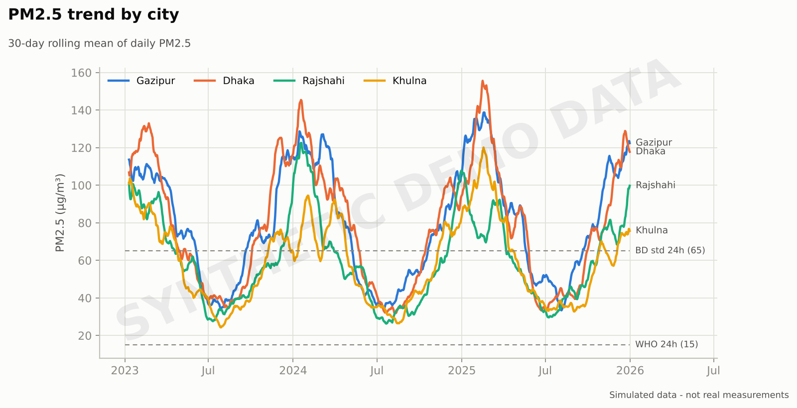
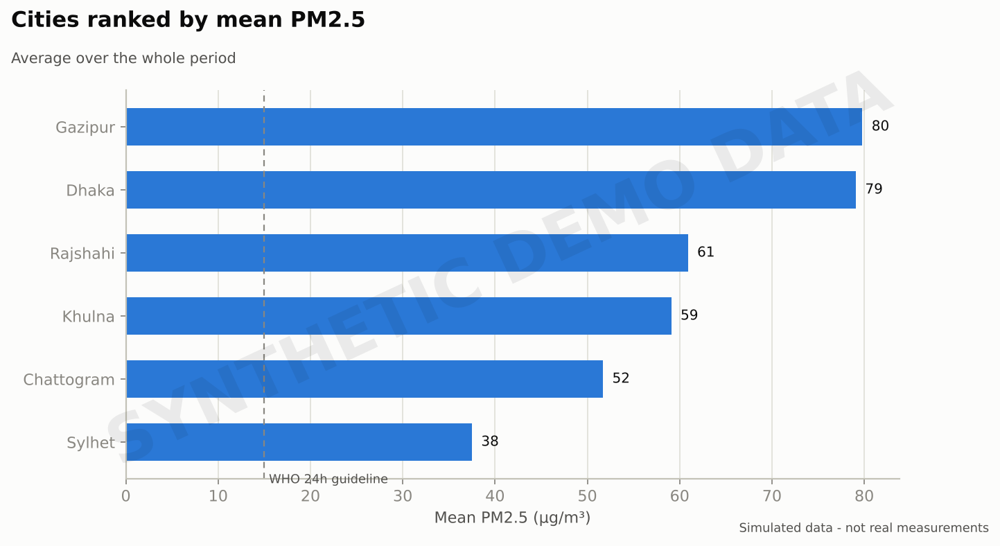
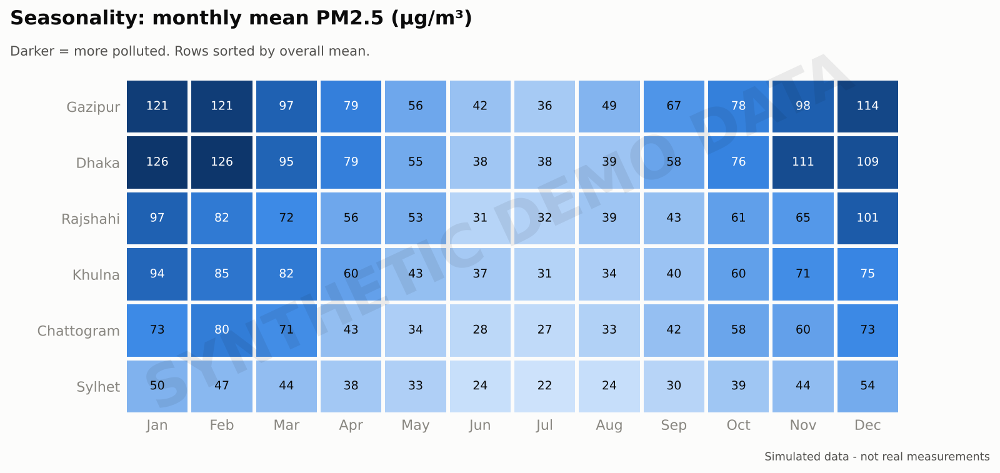
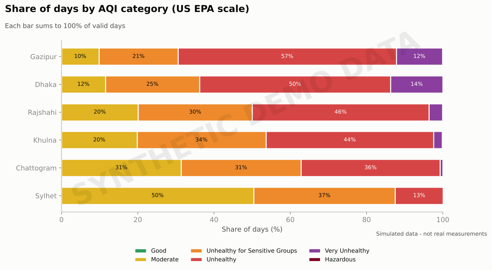
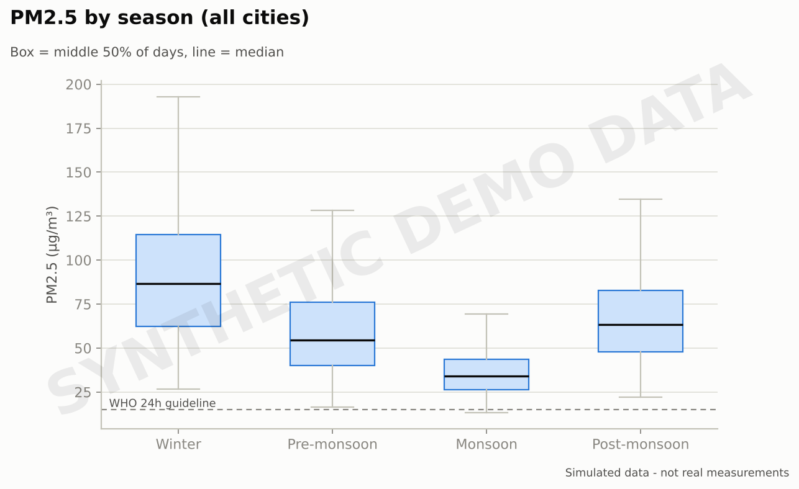
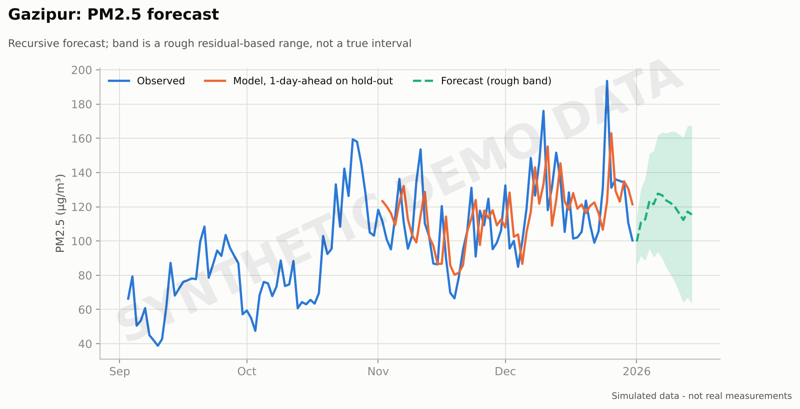
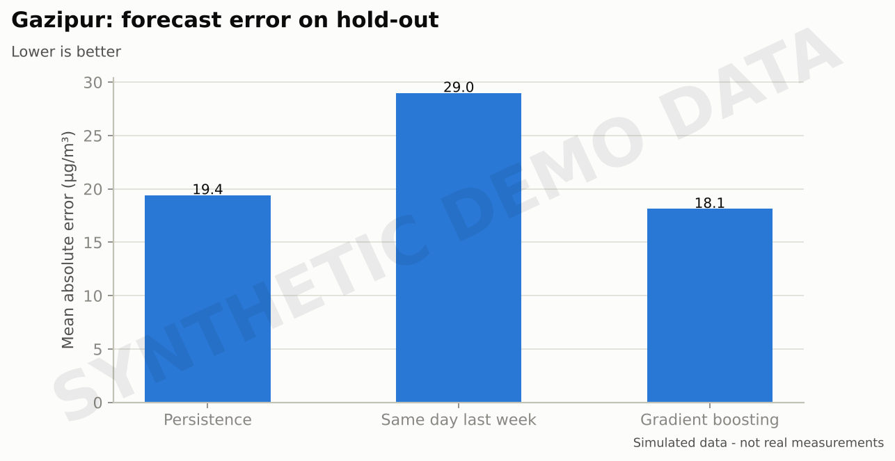

# 🌍 AirQuality BD

**Bangladesh air quality analytics: data collection, cleaning, analysis, visualization, an interactive dashboard and short-term forecasting, all in Python.**


> ⚠️ **Data honesty.** The charts in this README are built from **synthetic demo data** (clearly watermarked) so the project runs out of the box. They are **not** real measurements of Bangladesh air quality. To analyse real data, use the OpenAQ collector or your own CSV (see below). Real and synthetic data are always kept apart: every row carries an `is_synthetic` flag and the dashboard shows a warning banner when synthetic data is loaded.

## What it does

| Stage | What you get |
|---|---|
| Collect | OpenAQ v3 collector for Bangladesh stations, or load your own CSV |
| Clean | Date/city validation, impossible values → missing, duplicate merge, PM2.5 > PM10 flag |
| AQI | US EPA AQI for PM2.5 and PM10 (2024 breakpoints), category and dominant pollutant |
| Analyse | City ranking, monthly/seasonal patterns, days above WHO guideline and Bangladesh standard |
| Visualize | 7 publication-style charts + interactive Streamlit dashboard |
| Forecast | Gradient boosting vs. persistence vs. same-day-last-week, honest time-ordered evaluation |

## Charts (synthetic demo data)









## Quick start

```bash
git clone https://github.com/YOUR-USERNAME/airquality-bd.git
cd airquality-bd
python -m venv .venv && source .venv/bin/activate   # Windows: .venv\Scripts\activate
pip install -r requirements.txt

python scripts/run_pipeline.py --demo      # builds charts in outputs/figures
streamlit run app/dashboard.py             # opens the dashboard
pytest                                     # runs the tests
```

## Using real data

**Option 1: OpenAQ (free API key)**

1. Create an account at <https://explore.openaq.org> and copy your API key.
2. `export OPENAQ_API_KEY="your-key"` (Windows PowerShell: `$env:OPENAQ_API_KEY="your-key"`)
3. `python scripts/run_pipeline.py --openaq --from 2024-01-01 --to 2025-12-31`

Station coverage in Bangladesh is limited and uneven, so check how many days each city really has before drawing conclusions. The collector follows the OpenAQ v3 documentation; run it once with your key and inspect `data/raw/openaq_bd_daily.csv`.

**Option 2: your own CSV** with these columns:

```csv
date,city,pm25,pm10
2025-01-01,Dhaka,142.3,230.1
```

`python scripts/run_pipeline.py --csv data/raw/my_data.csv`, or upload it inside the dashboard.

## Project structure

```
airquality-bd/
├── airquality/        # the Python package
│   ├── aqi.py         # AQI calculation
│   ├── clean.py       # validation and cleaning
│   ├── collect.py     # OpenAQ collector + CSV loader
│   ├── sample_data.py # synthetic demo generator (always flagged)
│   ├── analysis.py    # summaries and pivots
│   ├── charts.py      # matplotlib charts
│   └── forecast.py    # forecasting models
├── app/dashboard.py   # Streamlit dashboard
├── scripts/run_pipeline.py
├── tests/             # pytest suite
├── data/{raw,sample}/
└── outputs/           # figures, city summary, run report
```

## Methods and limits

- **AQI** is the **US EPA** index, not the Bangladesh DoE index. Always state which one you report.
- **Reference lines:** WHO 2021 PM2.5 24-hour guideline (15 µg/m³) and the Bangladesh 24-hour standard (65 µg/m³). Check the latest DoE notification before quoting the national value in a paper.
- **Forecasting** is evaluated one day ahead on the last 60 days (never a shuffled split). Multi-day forecasts are recursive and less accurate; the shaded band is a rough residual-based range, not a true prediction interval.
- Forecast accuracy on synthetic data says nothing about accuracy on real data.

## Roadmap

- [ ] Add more real stations (DoE CAMS, community sensors) once a reliable source is confirmed
- [ ] Weather features (wind, rainfall, temperature) for forecasting
- [ ] Prophet / LSTM comparison
- [ ] Map view of stations
- [ ] Deploy dashboard on Streamlit Community Cloud

## বাংলায় সংক্ষেপে

AirQuality BD বাংলাদেশের বায়ুদূষণ (PM2.5, PM10, AQI) নিয়ে একটি Python Data Science প্রজেক্ট। এতে ডেটা সংগ্রহ, পরিষ্কার করা, বিশ্লেষণ, graph, interactive dashboard এবং forecasting আছে। README-র graph-গুলো **বানানো (synthetic) ডেটা** দিয়ে তৈরি, তাই সেগুলো বাস্তব পরিমাপ নয়। বাস্তব ডেটার জন্য OpenAQ API key বা নিজের CSV ব্যবহার করুন।

## License

MIT © Sohan Rana
